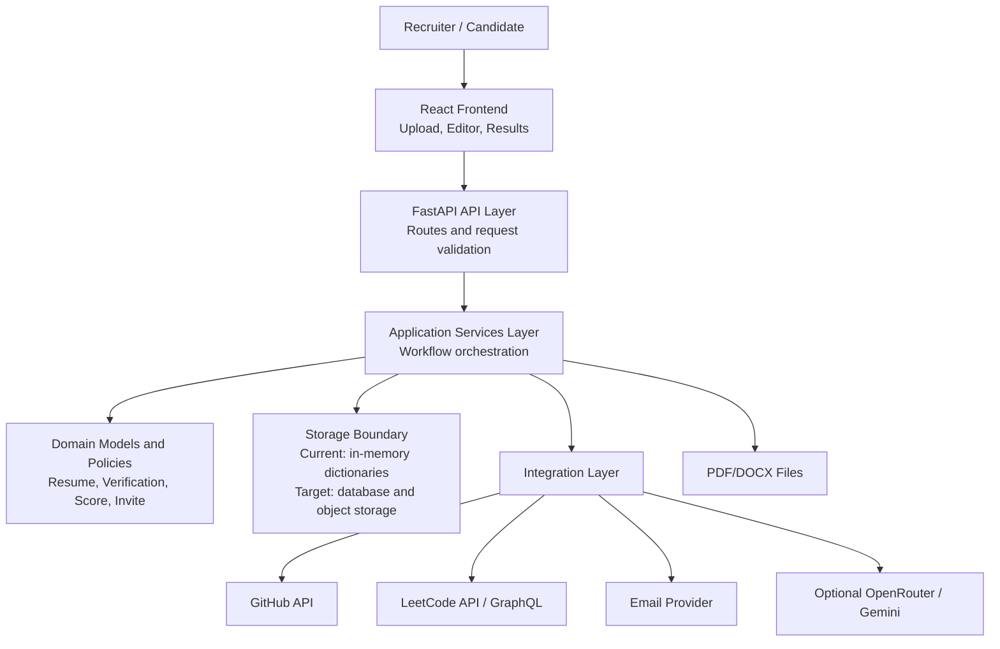
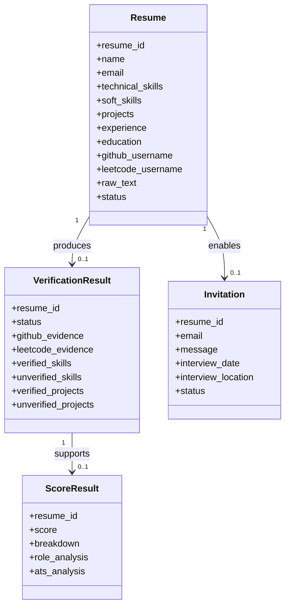
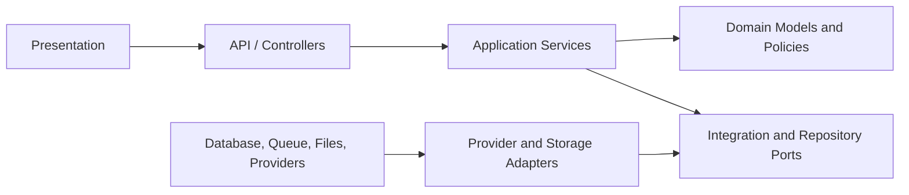
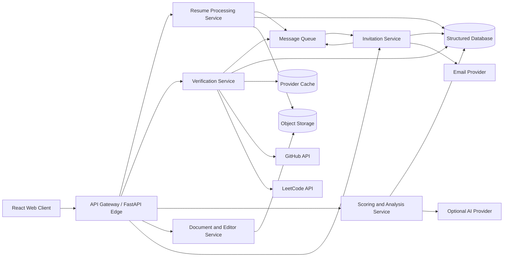
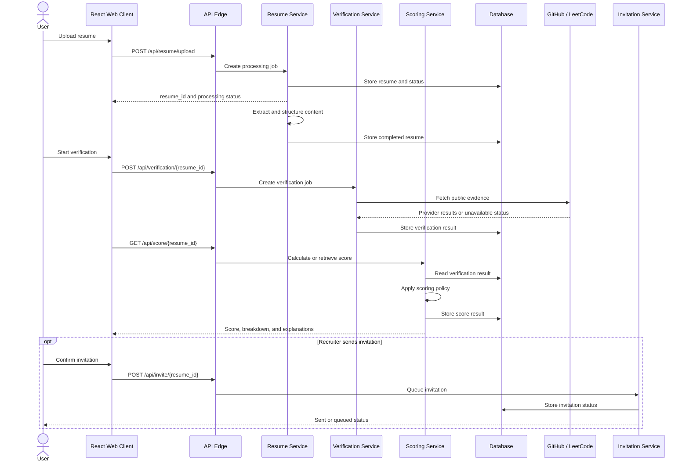

# ProfileAuditor Architectural Design

**Project:** ProfileAuditor  

## 1. Architecture Decision

ProfileAuditor will use a **layered monolithic architecture with microservice-inspired boundaries** for the MVP.

This approach keeps local development and deployment simple while separating responsibilities so that high-change or high-load capabilities can be extracted into services later. The current repository already follows useful boundaries between API endpoints, models, and business services.

## 2. Architectural Goals

- Keep the MVP easy to run, test, and deploy.
- Separate presentation, API, business logic, data, and integration concerns.
- Prevent external provider failures from breaking unrelated workflows.
- Make scoring, parsing, verification, ATS, and email capabilities independently testable.
- Support future extraction of verification and processing workloads into services.
- Protect candidate personal data and provider credentials.
- Provide clear status, error, and audit information to users.

## 3. Current Logical Architecture

## 4. Layered Architecture

### 4.1 Presentation Layer

**Responsibility:** Provide user workflows and render system state.

**Current components:**

- `frontend/src/App.js`
- `frontend/src/pages/UploadPage.js`
- `frontend/src/pages/ResultsPage.js`
- `frontend/src/pages/ResumeEditorPage.js`
- `frontend/src/components/`

**Responsibilities:**

- Collect resume files, candidate details, handles, and job descriptions.
- Call backend API endpoints.
- Show loading, success, processing, error, and unavailable-provider states.
- Display score evidence and limitations.
- Allow resume editing and DOCX export.

**Rules:**

- Do not calculate authoritative scores in the browser.
- Do not store provider secrets in frontend code.
- Do not hide unavailable or failed verification data.

### 4.2 API and Controller Layer

**Responsibility:** Expose HTTP contracts and translate requests into application operations.

**Current components:**

- `backend/app/main.py`
- `backend/app/api/routes.py`
- `backend/app/api/endpoints/resume.py`
- `backend/app/api/endpoints/verification.py`
- `backend/app/api/endpoints/score.py`
- `backend/app/api/endpoints/invite.py`

**Responsibilities:**

- Validate uploaded files and request payloads.
- Enforce workflow preconditions such as completed resume or available score.
- Return consistent response and error structures.
- Avoid embedding provider-specific business logic in route handlers.

### 4.3 Application Services Layer

**Responsibility:** Coordinate use cases and business workflows.

**Current components:**

- `backend/app/services/resume_parser.py`
- `backend/app/services/docx_service.py`
- `backend/app/services/scoring_service.py`
- `backend/app/services/ats_service.py`
- `backend/app/services/job_matching_service.py`
- `backend/app/services/email_service.py`
- `backend/app/services/github_service.py`
- `backend/app/services/leetcode_service.py`

**Suggested service boundaries:**

| Service | Main responsibility | Inputs | Outputs |
|---|---|---|---|
| Resume Processing | Extract text and structured resume data | PDF/DOCX | Resume data and processing status |
| Verification | Coordinate technical claim verification | Resume data and profile handles | Verification result |
| Scoring | Calculate Reality Score and breakdown | Verification evidence | Score response |
| ATS Analysis | Evaluate resume quality and machine readability | Resume text and parsed data | ATS analysis |
| Role Matching | Compare resume evidence with job description | Job description and evidence | Role-fit analysis |
| Invitation | Validate and queue interview email | Resume, score, invitation details | Invitation status |

**Rules:**

- Services should communicate through typed inputs and outputs.
- Provider calls should be isolated behind integration functions or adapters.
- A service should not directly manipulate frontend state.
- Long-running work should be queueable without changing the API contract.

### 4.4 Domain Model Layer

**Responsibility:** Define stable business data structures and policies.

**Current components:**

- `backend/app/models/resume.py`
- `backend/app/models/verification.py`
- `backend/app/models/score.py`
- `backend/app/models/invite.py`

**Core entities:**

**Domain policy requirements:**

- `processing`, `completed`, and `error` statuses must be explicit.
- A missing public profile must be distinguishable from provider failure.
- An unverified claim must not automatically mean a false claim.
- Technical skills and soft skills should be represented separately.
- Score values must remain within 0-100.

### 4.5 Data and Infrastructure Layer

**Responsibility:** Persist data, manage files, and provide operational infrastructure.

**Current state:**

- Resume, verification, and score results use in-memory dictionaries.
- Uploaded documents use temporary filesystem storage.
- Docker configuration supports deployment.

**Target state:**

- Relational database for structured resume, audit, score, and invitation records.
- Object storage for original and exported documents.
- Cache for provider responses and repeated score retrieval.
- Background queue for verification, document conversion, and email delivery.
- Centralized logs and metrics with sensitive-data filtering.

## 5. Dependency Rules

1. Presentation depends on API contracts, not internal services.
2. API controllers depend on application services.
3. Application services depend on domain models and ports.
4. Provider adapters implement integration ports.
5. Domain models must not depend on FastAPI, React, or provider SDK details.
6. Infrastructure details must be replaceable through adapters.

## 6. Microservice-Inspired Deployment View

The MVP can run as one backend container, but the following boundaries identify future independently deployable capabilities.

### 6.1 Candidate Services

| Service | Extraction trigger | Independent scaling reason |
|---|---|---|
| Resume Processing Service | Upload request or processing message | CPU and memory use varies by document and parser. |
| Verification Service | Verification command | External API latency and rate limits dominate workload. |
| Scoring and Analysis Service | Verification completed event | Scoring policy may evolve independently and can be audited by version. |
| Document and Editor Service | Editor upload or export request | File conversion has different dependencies and resource needs. |
| Invitation Service | Recruiter-approved invitation command | Email retries, delivery tracking, and compliance are separate concerns. |

### 6.2 Communication Style

- Use synchronous HTTP for short request-response operations such as retrieving results.
- Use asynchronous messages for parsing, verification, document conversion, and email delivery when processing time is unpredictable.
- Include `resume_id`, `audit_id`, `correlation_id`, and `policy_version` in messages.
- Make consumers idempotent so retries do not duplicate records or emails.
- Persist workflow status so the frontend can poll or subscribe to progress.

## 7. Main Workflow Deployment Sequence

## 8. Reliability and Failure Isolation

| Failure | Required behavior |
|---|---|
| Invalid document | Reject upload with a user-readable validation error. |
| Parser failure | Store `error` status and preserve a diagnostic identifier. |
| GitHub unavailable | Mark GitHub evidence unavailable; do not treat it as negative proof. |
| LeetCode unavailable | Mark LeetCode evidence unavailable; allow other evidence to be displayed. |
| Scoring failure | Return a recoverable error and do not display a fabricated score. |
| Email failure | Store failed delivery status and allow authorized retry. |
| Database outage | Fail safely, alert operators, and avoid reporting false completion. |
| Queue duplicate message | Use idempotency key to prevent duplicate processing or email. |

## 9. Security Architecture

- Store API keys and email credentials only in environment configuration or a secret manager.
- Use HTTPS in production.
- Apply authentication and role-based authorization before persistent multi-user deployment.
- Encrypt stored resume files and sensitive structured data.
- Minimize personal data in logs and redact provider responses where appropriate.
- Validate and sanitize uploaded filenames and document content.
- Apply retention and deletion policies to original files, extracted data, audit results, and email records.
- Display that results are automated decision-support signals, not final hiring decisions.

## 10. Deployment Recommendation

### MVP Deployment

- One React frontend container.
- One FastAPI backend container.
- Temporary filesystem for documents.
- In-memory stores only for demonstration or local development.
- External provider adapters with timeouts.

### Production-Ready Deployment

- React frontend served through a CDN or web server.
- FastAPI edge service behind HTTPS and an API gateway.
- Persistent database and object storage.
- Background queue and worker processes.
- Provider response cache and rate-limit controls.
- Centralized logs, metrics, health checks, and alerts.
- Authentication, authorization, backups, and disaster recovery.

## 11. Architecture Risks and Trade-offs

| Decision | Benefit | Trade-off |
|---|---|---|
| Start as a layered monolith | Lower deployment and development complexity. | Requires discipline to preserve service boundaries. |
| Use microservice-inspired boundaries | Enables later extraction and independent testing. | Adds interfaces and design overhead before services are deployed separately. |
| Async processing for long operations | Better responsiveness and retry behavior. | Requires queue, status tracking, and idempotency. |
| External verification providers | Useful evidence without maintaining all data sources. | Rate limits, outages, policy changes, and incomplete identity signals. |
| Explainable scoring | Better review quality and fairness. | More effort to preserve evidence and policy versions. |
| Persistent storage in production | Durability, auditability, and multi-user support. | Additional cost, security, migrations, and operations. |

## 12. Implementation Roadmap

1. Keep the current FastAPI backend as a layered modular monolith.
2. Move storage access behind repository interfaces.
3. Move GitHub and LeetCode calls behind provider adapter interfaces.
4. Add explicit workflow statuses and correlation IDs.
5. Add persistent database and object storage.
6. Add a queue for verification and email delivery.
7. Extract verification into an independent service only when scale, ownership, or provider isolation justifies it.
8. Add contract tests between the API edge and extracted services.

## 13. Architecture Review Checklist

- [ ] Each API endpoint delegates business decisions to an application service.
- [ ] Provider integrations are isolated behind adapters.
- [ ] Domain models do not depend on framework or provider details.
- [ ] Resume and audit data have an approved persistence and retention strategy.
- [ ] Missing evidence is distinguishable from provider failure.
- [ ] Long-running work has status tracking and retry behavior.
- [ ] Background consumers are idempotent.
- [ ] Secrets, personal data, and logs meet security requirements.
- [ ] Score policy and evidence are versioned for reproducibility.
- [ ] Architecture is tested with provider and database failure scenarios.

## 14. References

- SRS: [Software_Requirements_Specification.md](Software_Requirements_Specification.md)
- UML diagrams: [ProfileAuditor-UML.canvas](../ProfileAuditor-UML.canvas)
- Backend entry point: `backend/app/main.py`
- API routes: `backend/app/api/routes.py`
- Services: `backend/app/services/`
- Models: `backend/app/models/`
