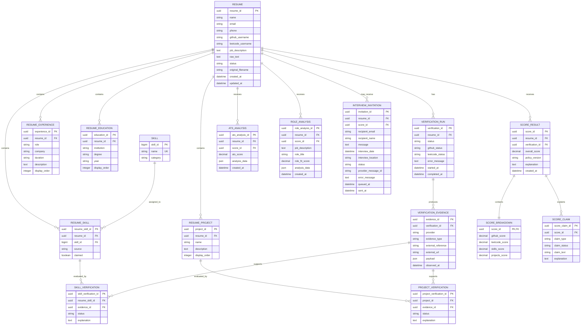

    # ProfileAuditor ER Diagram and Relational Schema

**Project:** ProfileAuditor  
**Version:** 1.0  
**Date:** 2026-10-07  
**Status:** Proposed persistent database design

> The current application uses in-memory dictionaries for resumes, verification results, and scores. This document defines the normalized relational schema recommended for persistent storage. The schema preserves the current API concepts while making claims, evidence, scores, and invitations queryable and auditable.

## 1. Entity Relationship Diagram



## 2. Entity Descriptions

| Entity | Purpose |
|---|---|
| `resume` | Stores candidate identity, source document metadata, extracted text, handles, and processing status. |
| `skill` | Provides a reusable vocabulary for technical and soft skills. |
| `resume_skill` | Resolves the many-to-many relationship between resumes and skills and records the claim source. |
| `resume_project` | Stores projects extracted from a resume. |
| `resume_experience` | Stores work or project experience entries. |
| `resume_education` | Stores education entries. |
| `verification_run` | Represents one verification attempt for a resume. |
| `verification_evidence` | Stores normalized references and raw provider evidence from GitHub or LeetCode. |
| `skill_verification` | Records whether a claimed skill is verified, unverified, or unavailable. |
| `project_verification` | Records whether a claimed project is verified, unverified, or unavailable. |
| `score_result` | Stores the overall Reality Score and scoring policy version. |
| `score_breakdown` | Stores GitHub, LeetCode, skill, and project component scores. |
| `score_claim` | Stores claim-level explanations included in a score result. |
| `ats_analysis` | Stores ATS health results for a resume or score run. |
| `role_analysis` | Stores optional job-description and role-fit results. |
| `interview_invitation` | Stores invitation details, queue state, delivery state, and failures. |

## 3. Relational Schema

The following definitions use PostgreSQL-style SQL. `jsonb` is used only where provider payloads or analysis structures are expected to vary.

```sql
CREATE TABLE resume (
    resume_id UUID PRIMARY KEY,
    name VARCHAR(200),
    email VARCHAR(320),
    phone VARCHAR(50),
    github_username VARCHAR(100),
    leetcode_username VARCHAR(100),
    job_description TEXT,
    raw_text TEXT,
    original_filename VARCHAR(255),
    status VARCHAR(20) NOT NULL CHECK (status IN ('processing', 'completed', 'error')),
    created_at TIMESTAMPTZ NOT NULL DEFAULT CURRENT_TIMESTAMP,
    updated_at TIMESTAMPTZ NOT NULL DEFAULT CURRENT_TIMESTAMP
);

CREATE TABLE skill (
    skill_id BIGSERIAL PRIMARY KEY,
    name VARCHAR(100) NOT NULL UNIQUE,
    category VARCHAR(20) NOT NULL CHECK (category IN ('technical', 'soft'))
);

CREATE TABLE resume_skill (
    resume_skill_id UUID PRIMARY KEY,
    resume_id UUID NOT NULL REFERENCES resume(resume_id) ON DELETE CASCADE,
    skill_id BIGINT NOT NULL REFERENCES skill(skill_id),
    source VARCHAR(30) NOT NULL DEFAULT 'resume',
    claimed BOOLEAN NOT NULL DEFAULT TRUE,
    UNIQUE (resume_id, skill_id)
);

CREATE TABLE resume_project (
    project_id UUID PRIMARY KEY,
    resume_id UUID NOT NULL REFERENCES resume(resume_id) ON DELETE CASCADE,
    name VARCHAR(255) NOT NULL,
    description TEXT,
    display_order INTEGER NOT NULL DEFAULT 0
);

CREATE TABLE resume_experience (
    experience_id UUID PRIMARY KEY,
    resume_id UUID NOT NULL REFERENCES resume(resume_id) ON DELETE CASCADE,
    role VARCHAR(200),
    company VARCHAR(200),
    duration VARCHAR(100),
    description TEXT,
    display_order INTEGER NOT NULL DEFAULT 0
);

CREATE TABLE resume_education (
    education_id UUID PRIMARY KEY,
    resume_id UUID NOT NULL REFERENCES resume(resume_id) ON DELETE CASCADE,
    institution VARCHAR(255),
    degree VARCHAR(255),
    year VARCHAR(50),
    display_order INTEGER NOT NULL DEFAULT 0
);

CREATE TABLE verification_run (
    verification_id UUID PRIMARY KEY,
    resume_id UUID NOT NULL REFERENCES resume(resume_id) ON DELETE CASCADE,
    status VARCHAR(20) NOT NULL CHECK (status IN ('processing', 'completed', 'error')),
    github_status VARCHAR(20) NOT NULL DEFAULT 'not_requested',
    leetcode_status VARCHAR(20) NOT NULL DEFAULT 'not_requested',
    error_message TEXT,
    started_at TIMESTAMPTZ NOT NULL DEFAULT CURRENT_TIMESTAMP,
    completed_at TIMESTAMPTZ
);

CREATE TABLE verification_evidence (
    evidence_id UUID PRIMARY KEY,
    verification_id UUID NOT NULL REFERENCES verification_run(verification_id) ON DELETE CASCADE,
    provider VARCHAR(30) NOT NULL CHECK (provider IN ('github', 'leetcode')),
    evidence_type VARCHAR(50) NOT NULL,
    external_reference VARCHAR(255),
    external_url TEXT,
    payload JSONB NOT NULL DEFAULT '{}'::jsonb,
    observed_at TIMESTAMPTZ NOT NULL DEFAULT CURRENT_TIMESTAMP
);

CREATE TABLE skill_verification (
    skill_verification_id UUID PRIMARY KEY,
    resume_skill_id UUID NOT NULL REFERENCES resume_skill(resume_skill_id) ON DELETE CASCADE,
    evidence_id UUID REFERENCES verification_evidence(evidence_id) ON DELETE SET NULL,
    status VARCHAR(20) NOT NULL CHECK (status IN ('verified', 'unverified', 'unavailable')),
    explanation TEXT
);

CREATE TABLE project_verification (
    project_verification_id UUID PRIMARY KEY,
    project_id UUID NOT NULL REFERENCES resume_project(project_id) ON DELETE CASCADE,
    evidence_id UUID REFERENCES verification_evidence(evidence_id) ON DELETE SET NULL,
    status VARCHAR(20) NOT NULL CHECK (status IN ('verified', 'unverified', 'unavailable')),
    explanation TEXT
);

CREATE TABLE score_result (
    score_id UUID PRIMARY KEY,
    resume_id UUID NOT NULL REFERENCES resume(resume_id) ON DELETE CASCADE,
    verification_id UUID NOT NULL REFERENCES verification_run(verification_id),
    overall_score NUMERIC(5,2) NOT NULL CHECK (overall_score BETWEEN 0 AND 100),
    policy_version VARCHAR(50) NOT NULL,
    explanation TEXT,
    created_at TIMESTAMPTZ NOT NULL DEFAULT CURRENT_TIMESTAMP
);

CREATE TABLE score_breakdown (
    score_id UUID PRIMARY KEY REFERENCES score_result(score_id) ON DELETE CASCADE,
    github_score NUMERIC(5,2) NOT NULL CHECK (github_score BETWEEN 0 AND 100),
    leetcode_score NUMERIC(5,2) NOT NULL CHECK (leetcode_score BETWEEN 0 AND 100),
    skills_score NUMERIC(5,2) NOT NULL CHECK (skills_score BETWEEN 0 AND 100),
    projects_score NUMERIC(5,2) NOT NULL CHECK (projects_score BETWEEN 0 AND 100)
);

CREATE TABLE score_claim (
    score_claim_id UUID PRIMARY KEY,
    score_id UUID NOT NULL REFERENCES score_result(score_id) ON DELETE CASCADE,
    claim_type VARCHAR(30) NOT NULL,
    claim_status VARCHAR(20) NOT NULL CHECK (claim_status IN ('verified', 'unverified', 'unavailable')),
    claim_text TEXT NOT NULL,
    explanation TEXT
);

CREATE TABLE ats_analysis (
    ats_analysis_id UUID PRIMARY KEY,
    resume_id UUID NOT NULL REFERENCES resume(resume_id) ON DELETE CASCADE,
    score_id UUID REFERENCES score_result(score_id) ON DELETE SET NULL,
    ats_score NUMERIC(5,2) CHECK (ats_score BETWEEN 0 AND 100),
    analysis_data JSONB NOT NULL DEFAULT '{}'::jsonb,
    created_at TIMESTAMPTZ NOT NULL DEFAULT CURRENT_TIMESTAMP
);

CREATE TABLE role_analysis (
    role_analysis_id UUID PRIMARY KEY,
    resume_id UUID NOT NULL REFERENCES resume(resume_id) ON DELETE CASCADE,
    score_id UUID REFERENCES score_result(score_id) ON DELETE SET NULL,
    job_description TEXT,
    role_title VARCHAR(255),
    role_fit_score NUMERIC(5,2) CHECK (role_fit_score BETWEEN 0 AND 100),
    analysis_data JSONB NOT NULL DEFAULT '{}'::jsonb,
    created_at TIMESTAMPTZ NOT NULL DEFAULT CURRENT_TIMESTAMP
);

CREATE TABLE interview_invitation (
    invitation_id UUID PRIMARY KEY,
    resume_id UUID NOT NULL REFERENCES resume(resume_id) ON DELETE CASCADE,
    score_id UUID REFERENCES score_result(score_id) ON DELETE SET NULL,
    recipient_email VARCHAR(320) NOT NULL,
    recipient_name VARCHAR(200),
    message TEXT,
    interview_date TIMESTAMPTZ,
    interview_location VARCHAR(500),
    status VARCHAR(20) NOT NULL CHECK (status IN ('queued', 'sent', 'failed')),
    provider_message_id VARCHAR(255),
    error_message TEXT,
    queued_at TIMESTAMPTZ NOT NULL DEFAULT CURRENT_TIMESTAMP,
    sent_at TIMESTAMPTZ
);
```

## 4. Relationship Rules and Cardinality

| Relationship | Cardinality | Rule |
|---|---:|---|
| Resume to resume skills | 1:N | A resume can contain many claimed skills. |
| Skill to resumes | N:M through `resume_skill` | A reusable skill can occur in many resumes. |
| Resume to projects | 1:N | A resume can contain zero or more projects. |
| Resume to verification runs | 1:N | A resume may be re-verified after a retry or policy change. |
| Verification run to evidence | 1:N | A run may collect multiple GitHub and LeetCode evidence records. |
| Resume skill to skill verification | 1:N | A claim may be evaluated across multiple verification runs. |
| Resume project to project verification | 1:N | A project may be evaluated across multiple verification runs. |
| Verification run to score result | 1:N | A run can have recalculated scores under different policies. |
| Score result to score breakdown | 1:1 | Every score result has one component breakdown. |
| Resume to ATS analysis | 1:N | Edited versions or repeated analyses can be retained. |
| Resume to role analysis | 1:N | A resume may be compared with multiple job descriptions. |
| Resume to invitation | 1:N | A candidate may receive multiple invitations or retries. |

## 5. Indexes and Constraints

Recommended indexes:

```sql
CREATE INDEX idx_resume_email ON resume(email);
CREATE INDEX idx_resume_status ON resume(status);
CREATE INDEX idx_verification_resume ON verification_run(resume_id, started_at DESC);
CREATE INDEX idx_evidence_verification ON verification_evidence(verification_id);
CREATE INDEX idx_evidence_provider ON verification_evidence(provider);
CREATE INDEX idx_score_resume ON score_result(resume_id, created_at DESC);
CREATE INDEX idx_invitation_resume ON interview_invitation(resume_id, queued_at DESC);
CREATE INDEX idx_invitation_status ON interview_invitation(status);
```

Important constraints:

- Use UUIDs for externally visible identifiers.
- Use foreign keys and cascading deletes for dependent resume data.
- Use controlled status values rather than arbitrary strings.
- Preserve historical verification and score runs instead of overwriting them.
- Store a scoring `policy_version` so results remain reproducible.
- Treat `unavailable` separately from `unverified`.
- Encrypt or restrict access to email, phone, raw resume text, and provider payloads.

## 6. Mapping from Current Models

| Current model / store | Relational mapping |
|---|---|
| `ResumeData` and `resume_storage` | `resume`, `resume_skill`, `resume_project`, `resume_experience`, `resume_education` |
| `VerificationResult` and `verification_storage` | `verification_run`, `verification_evidence`, `skill_verification`, `project_verification` |
| `ScoreResponse` and `score_storage` | `score_result`, `score_breakdown`, `score_claim`, `ats_analysis`, `role_analysis` |
| `InviteRequest` / `InviteResponse` | `interview_invitation` |
| Temporary uploaded file | Object storage reference associated with `resume.original_filename` or a future document table |

## 7. Example Queries

### Retrieve the latest score and breakdown

```sql
SELECT
    r.resume_id,
    r.name,
    s.overall_score,
    b.github_score,
    b.leetcode_score,
    b.skills_score,
    b.projects_score,
    s.policy_version
FROM resume r
JOIN score_result s ON s.resume_id = r.resume_id
JOIN score_breakdown b ON b.score_id = s.score_id
WHERE r.resume_id = :resume_id
ORDER BY s.created_at DESC
LIMIT 1;
```

### List verified and unavailable claims

```sql
SELECT
    'skill' AS claim_type,
    sk.name AS claim,
    sv.status,
    sv.explanation
FROM skill_verification sv
JOIN resume_skill rs ON rs.resume_skill_id = sv.resume_skill_id
JOIN skill sk ON sk.skill_id = rs.skill_id
WHERE rs.resume_id = :resume_id
UNION ALL
SELECT
    'project' AS claim_type,
    rp.name AS claim,
    pv.status,
    pv.explanation
FROM project_verification pv
JOIN resume_project rp ON rp.project_id = pv.project_id
WHERE rp.resume_id = :resume_id;
```

### Find invitation delivery failures

```sql
SELECT
    invitation_id,
    resume_id,
    recipient_email,
    error_message,
    queued_at
FROM interview_invitation
WHERE status = 'failed'
ORDER BY queued_at DESC;
```

## 8. Privacy and Retention Notes

- Resume text, contact details, job descriptions, and provider payloads are sensitive data.
- Access must be restricted by authenticated user and role before production use.
- Retention duration must be approved by the privacy stakeholder.
- Deletion must remove the resume and dependent records or apply an approved anonymization policy.
- Provider payloads should be minimized to evidence needed for explanation and auditability.
- Logs should reference IDs and correlation IDs instead of copying resume text or credentials.

## 9. References

- Resume model: `backend/app/models/resume.py`
- Verification model: `backend/app/models/verification.py`
- Score model: `backend/app/models/score.py`
- Invitation model: `backend/app/models/invite.py`
- SRS: [Software_Requirements_Specification.md](Software_Requirements_Specification.md)
- Architecture: [Architectural_Design.md](Architectural_Design.md)
